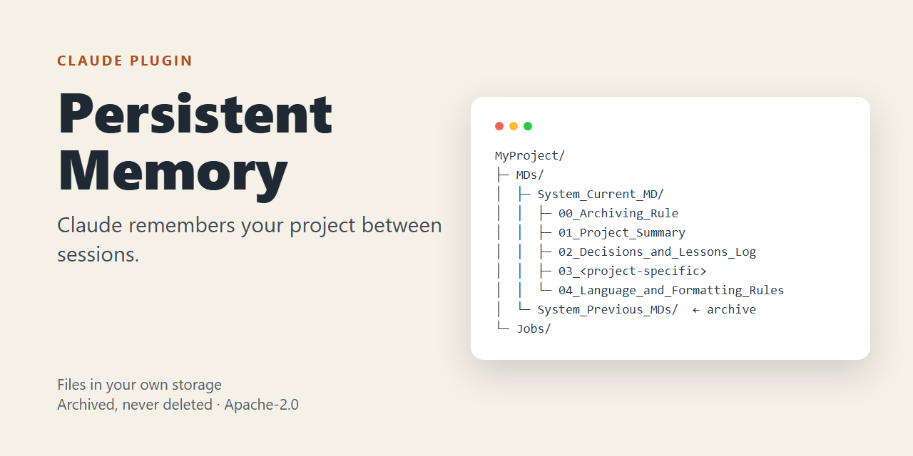
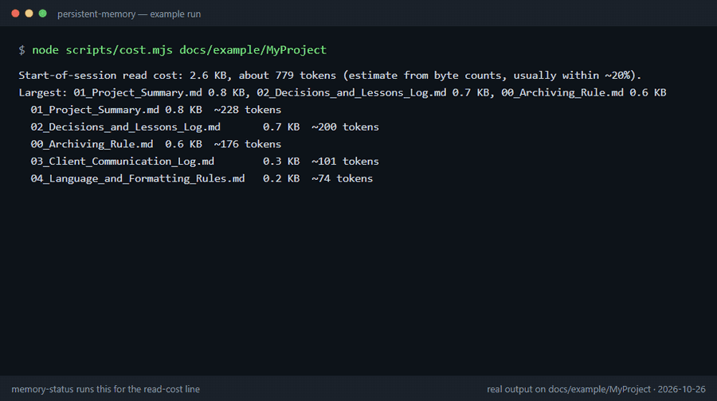

# Persistent Memory — إضافة لـClaude (v1.8.1)

[English README](README.md) · [دليل التثبيت (عربي وإنجليزي)](INSTALL.md)



**Claude ينسى سياق مشروعك بين الجلسات. هذي الإضافة تخليه يتذكر.**

تحفظ الإضافة مجموعة ملفات نصية بسيطة (الحالة الحالية، القرارات، التواريخ المهمة، الدروس) في تخزين **تملكه أنت**: Dropbox أو Drive أو M365 أو Notion أو مجلد محلي. في بداية كل جلسة يقرأ Claude هذي الملفات كاملة، ويحفظ قبل ما ينفّذ، و**ما يحذف شي**: أي ملف يتبدّل ينتقل لأرشيف.

تصلح لأي مشروع طويل، مو بس البرمجة: عمل حر، تجارة، تفاوض، بحث، مشروع عائلي. وتوفّر عليك إعادة شرح المشروع كل جلسة.

**الأمان في سطر:** الـhook يعرض أسماء الملفات وتواريخها فقط (بدون محتواها) ولا يكتب شيئاً داخل مشروعك، وما فيه وصول للشبكة ولا تحديث ذاتي، ومحتوى ملفات الذاكرة يُعامَل كبيانات مو كتعليمات (التفاصيل في [الأمان](#الأمان)).

## شكل المجلد

بعد الإعداد الأول يحتوي مجلد مشروعك على هيكل مثل هذا (الأسماء كما يحدّدها الـskill):

```
MyProject/
└─ MDs/
   ├─ System_Current_MD/                 <- اللي يقراه Claude كاملاً أول كل جلسة
   │  ├─ 00_Archiving_Rule               حالة حالية، تُستبدل كاملة عند كل تحديث
   │  ├─ 01_Project_Summary              حالة حالية، تُستبدل كاملة عند كل تحديث
   │  ├─ 02_Decisions_and_Lessons_Log    سجل قرارات ودروس، يُضاف إليه فقط
   │  ├─ 03_<اسم خاص بالمشروع>           سجل سردي، يُضاف إليه فقط
   │  └─ 04_Language_and_Formatting_Rules  حالة حالية، تُستبدل كاملة
   └─ System_Previous_MDs/               <- كل نسخة مستبدَلة تنتقل هنا ولا تُحذف
```

في [`docs/example/`](docs/example/) مجلد ذاكرة **مثال وهمي** تقدر تقراه لتفهم الشكل، أو تشغّل عليه أدوات الإضافة بنفسك وتشوف المخرجات (الأوامر مكتوبة هناك). الملفات مكتوبة يدوياً كمثال، مو مولّدة بالـskill.

## شوفها وهي تشتغل

مخرجات حقيقية لسكربتات الإضافة ولـhook بداية الجلسة على ذاك المجلد المثال (التُقطت 2026-10-26؛ نص كل لقطة في [`docs/example/README.md`](docs/example/README.md)). تعرض سطر تكلفة القراءة وفحص الصحة والـlint وما يظهر لـClaude عند بداية الجلسة. ما تعرض محادثة مع Claude، لأن الـskill يشتغل داخل Claude.



## البدء السريع (Claude Code)

```
/plugin marketplace add msamkari/samkari-plugins
/plugin install persistent-memory@samkari-plugins
```

بعدها قل لـClaude مثلاً: *"Build a persistent memory system for my project."* يسألك أسئلة إعداد بسيطة (اللغة، مكان حفظ الملفات، تسمية الملفات)، ويبني الهيكل، ومن الجلسة الجاية يقرأ الملفات أول ويكمل من وين وقفت. لمعرفة حالة الذاكرة في أي وقت: `/persistent-memory:memory-status`.

**تثبيت واحد لكل المشاريع.** ثبّتها مرة واحدة لنفسك (نطاق المستخدم) فتخدم كل المجلدات؛ لا تثبيت ولا نسخ لكل مشروع. أول مرة تفتح مشروعاً ليس فيه نظام ذاكرة يعرض عليك Claude في جملة واحدة أن يجهّزه، ولا ينشئ ملفات إلا بعد ما تقول نعم في المحادثة. قل لا فلا يُعرض هناك مرة ثانية. التفاصيل: [`docs/onboarding.md`](docs/onboarding.md).

خطوات التثبيت لويندوز وماك ولينكس والتحديث التلقائي وحل المشكلات في [`INSTALL.md`](INSTALL.md). المنصات الأخرى تحت [التثبيت في أماكن أخرى](#التثبيت-في-أماكن-أخرى).

## وش تحتوي

| الجزء | وين يشتغل | وش يسوي |
|---|---|---|
| Skill `persistent-memory-system` | claude.ai وCowork وClaude Code | النظام الكامل (مطابق بايت ببايت للـskill المنشور v8.1) |
| Skill `memory-status` | Claude Code / Cowork (سطر التكلفة يحتاج Node) | حالة قراءة فقط لمجلد الذاكرة المحلي (`/persistent-memory:memory-status`)، مع تقدير تكلفة الرموز (tokens) للملفات اللي تُقرأ كاملة في بداية كل جلسة |
| Skill `memory-lint` | Claude Code / Cowork (يحتاج Node) | فحوص حتمية لترقيم المدخلات، والإشارات لمدخلات غير موجودة، وروابط الأرشيف. الخيار `--apply` يصلح فقط أخطاء المسارات الفريدة ويؤرشف الملف القديم أولاً. ما يقدر يحكم على صحة الوقائع؛ هذا شغل الوكيل المدقّق |
| Skill `memory-doctor` | Claude Code / Cowork (يحتاج Node) | فحص صحة واحد للقراءة فقط: ملفات ناقصة أو فارغة، نسخ تعارض المزامنة، أسرار، نص يحاول توجيه المساعد. يفشل بأمان (يرفض عند الشك) |
| Skill `memory-pending` | Claude Code / Cowork | صيغة موحدة للبنود المعلّقة: الاقتباس، ومن قاله، ودرجة الثقة، وسبب التعليق. نص الطرف الثالث لا يُسجَّل أبداً على أنه كلامك |
| Skill `memory-activity` | Claude Code / Cowork (يحتاج Node) | سجل تدقيق يُضاف إليه فقط (`Activity_Log/activity.jsonl`): ماذا عُمل وبأي موافقة. ليس جزءاً من القراءة الإلزامية في بداية الجلسة |
| Skill `notebooklm-reference` | Claude Code / Cowork | **دليل اختياري وليس موصّلاً.** لا يوجد موصّل رسمي بين Claude وحساب NotebookLM الشخصي. يبدأ بمسار يدوي آمن لوثائق كبيرة وغير حساسة، ثم يشرح فقط أدوات الطرف الثالث غير الرسمية، وكل خطوة بموافقتك. لا يُستخدم أبداً لملفات الذاكرة (فيه تحذير خصوصية) |
| Skill `memory-continuity` | Claude Code / Cowork (قالب الجرد يحتاج Node) | طبقة تسليم اختيارية: ملف مدخل HANDOVER.md ومؤشّر في CLAUDE.md، وسكربت جرد/manifest قابل للضبط، واختبار طفرات لسكربتات الفحص، واختبار بدء بارد يستخدم الوكيل `memory-verifier` (قراءة فقط). الـhook يوجّه المحادثة الجديدة إلى HANDOVER.md. انظر [`docs/continuity.md`](docs/continuity.md) |
| Skill `memory-setup` | Claude Code / Cowork (يحتاج Node) | يجهّز مشروعاً ليس فيه نظام ذاكرة، وبعد موافقتك فقط: ملف `HANDOVER.md` فيه بلوك «ابدأ من هنا» واحد، وسجل العمل، وملف الحالة (manifest)، ومجلدات الأرشيف، وإعداد فحص نهاية العمل. يعرض الخطة أولاً، ولا يستبدل أي ملف، ولا ينسخ أي سكربت إلى المشروع. يعرض الإضافة المرافقة الاختيارية `vitals` ولا يثبّتها أبداً. انظر [`docs/onboarding.md`](docs/onboarding.md) |
| Skill `memory-archive` | Claude Code / Cowork (يحتاج Node) | الأرشفة قبل الكتابة: ينسخ الملف إلى مجلد أرشيف المشروع باسم مؤرَّخ مع حرف لنسخ اليوم نفسه (a ثم b ثم c)، ولا يستبدل نسخة موجودة، ويتحقق من النسخة. مكان الأرشفة يحدده ملف المشروع نفسه `MDs/archive.json` |
| Skill `memory-log` | Claude Code / Cowork (يحتاج Node) | يضيف سطراً واحداً إلى سجل الـJob (داخل `Jobs/` أو `MDs/` فقط) من جلسة مجدولة أو غير مراقَبة بلا تعقيدات علامات الاقتباس: إلحاق فقط، سطر واحد، لا يخرج من المشروع ولا يتبع الروابط ولا ينشئ مجلدات (`scripts/joblog.mjs`). يتيح قاعدة إذن ضيقة واحدة بدل `Bash(printf:*)` الواسعة |
| Agent `memory-verifier` | Claude Code / Cowork | تدقيق قراءة فقط: هل ملف الحالة يطابق السجل؟ |
| Hook بداية الجلسة | Claude Code وCowork فقط | يحقن فهرساً مختصراً (أسماء الملفات وتواريخها، لا المحتوى أبداً)، وإن كان في المشروع HANDOVER.md يذكر مساره. في مشروع ليس فيه نظام ذاكرة يضيف ملاحظة ليعرض Claude الإعداد (مرة، وتذكير واحد بعد 14 يوماً إن لم يجب أحد؛ وكلمة «لا» تنهيه). صامت في غير ذلك، وصامت دائماً في المجلدات التي ليست مشاريع |
| Hook الإيقاف Stop (اختياري) | Claude Code وCowork فقط | لا يفعل شيئاً إلا إذا كان في المشروع `MDs/freshness.json`. معه: يمنع إنهاء الدور مرة واحدة (في كل دور) حين تكون هذي الجلسة كتبت ملفات عمل ولم تُحدَّث ملفات حالة المشروع (HANDOVER وmanifest) بعدها. يقرأ أوقات الملفات ونص الجلسة فقط. انظر [`docs/end-of-work.md`](docs/end-of-work.md) |
| بوابة الموافقة PreToolUse | Claude Code وCowork فقط | لا تقدر إلا أن تمنع أو تسأل، ولا توافق على أي أمر أبداً. تمنع نص `git commit` و`gh pr` اللي فيه Co-Authored-By أو روابط جلسات أو توقيعات أدوات (إلا مع `PMS_ALLOW_TRAILERS=1` حين تريدها صراحة)، وتسألك قبل أي force push. تُسجَّل القرارات إذا حُدّد مجلد الذاكرة |

الـhooks والـagents تُتجاهل في دردشة claude.ai؛ الـskill يشتغل في كل مكان.

## ماذا يعمل على جهازك

عند التثبيت تظهر لك رسالة من Claude مثل "includes components that run code" (تتضمن مكوّنات تشغّل شيفرة). هذه رسالة عامة تظهر لأي إضافة فيها hooks، وليست خاصة بهذه الإضافة. هذا ما تفعله الشيفرة بالضبط:

| الـHook | متى يعمل | ماذا يقرأ | ماذا يكتب | الشبكة |
|---|---|---|---|---|
| SessionStart | عند بدء الجلسة أو استئنافها | أسماء الملفات وتواريخها في مجلد الذاكرة (إن حدّدته)، ومسار `HANDOVER.md` إن وُجد، وأسماء العناصر في أعلى مجلد المشروع (ليعرف هل هو مشروع بلا نظام ذاكرة)؛ لا محتوى الملفات أبداً | لا يكتب داخل مشروعك أبداً. فقط حين يعرض الإعداد: ملف علامة صغير في مجلد بيانات الإضافة نفسها (`onboarding/<hash>.json`: كلمة حالة وتاريخ، بلا مسار وبلا اسم مشروع)، حتى لا يظهر العرض أكثر من مرتين (العرض وتذكير واحد بعد 14 يوماً، ملف علامة ثانٍ `<hash>.2.json`) | لا يوجد |
| Stop (اختياري) | عند انتهاء Claude من الرد | فقط في مشروع فيه `MDs/freshness.json`: أوقات الملفات ونص الجلسة الحالية | لا شيء؛ قد يطلب من Claude مرة واحدة (في كل دور) تحديث ملفات الحالة | لا يوجد |
| PreToolUse (Bash) | قبل أي أمر shell | نص كل أمر shell؛ ولا يتصرف إلا مع `git commit`/`git tag` و`gh pr` و`git push` | فقط عندما يمنع أو يسأل، وإن حُدّد مجلد الذاكرة: سطر يُضاف إلى `Activity_Log/activity.jsonl`؛ لا يعدّل ولا يحذف أي شيء آخر | لا يوجد |

كل الـhooks سكربتات Node.js بسيطة في مجلد `hooks/` ويمكنك قراءتها قبل التثبيت. لا تثبّت شيئاً ولا تحدّث نفسها ولا ترسل بيانات لأي جهة. والمهارة الاختيارية `notebooklm-reference` لا تثبّت شيئاً بنفسها؛ أي أداة طرف ثالث تشرحها لا تُثبَّت إلا بعد قولك "نعم" في المحادثة.

## التثبيت في أماكن أخرى

**Cowork / claude.ai:** ارفع هذا المستودع كملف zip (ملفات الإضافة في جذر الـzip؛ zip واحد، لا zip داخل zip).

**تجربة يدوية بدون تثبيت:** `claude --plugin-dir .`

إعداد اختياري `memory_dir`: مجلد الذاكرة المحلي عندك (مثلاً مجلد Dropbox المتزامن). الـhook فقط هو اللي يستخدمه.

## اسمان، نظام واحد

الإضافة اسمها `persistent-memory`، والـskill اللي بداخلها اسمه `persistent-memory-system`. إذا كنت مثبّت الـskill المستقل القديم أيضاً، **عطّل واحداً منهما** لتجنّب التكرار. أوامر التثبيت أعلاه تستخدم الـmarketplace `msamkari/samkari-plugins`؛ وهذا المستودع يحتوي مصدر الإضافة.

## حدود معروفة

- الـhooks والـagents تشتغل في Claude Code وCowork فقط، مو في دردشة claude.ai.
- ويندوز: الـhook مكتوب بـNode (`.mjs`) ولا يحتاج bash، واختبارات CI تنجح على ويندوز، وجُرِّب hook الـStop الاختياري داخل جلسات Claude Code حقيقية على ويندوز (أربع حالات). hook بداية الجلسة لوحظ يعمل في الجلسات نفسها، أما بوابة الموافقة فلم تُجرَّب في جلسة حقيقية بعد.
- أغلب أدوات الصيانة والـhooks (`memory-status` و`memory-lint` و`memory-doctor` و`memory-activity`) تحتاج Node.js.
- عرض الإعداد (v1.7.0) مغطّى باختبارات تشغّل الـhook كعملية على مشروع مصطنع؛ ولم يُشاهَد بعد في جلسة تفاعلية حقيقية. يظهر مرة، مع تذكير واحد بعد 14 يوماً دون جواب، فالجلسة الأولى غير المراقَبة تستهلك الأولى (شغّل الـskill `memory-setup` بالاسم، أو انظر `reset` في [`docs/onboarding.md`](docs/onboarding.md)).
- hook الـStop يقارن أوقات الملفات، فيكشف "تغيّر شيء" لا "المحتوى صحيح"؛ حدوده في [`docs/end-of-work.md`](docs/end-of-work.md).
- الـskill يحتاج تخزيناً متصلاً (موصل سحابي أو مجلد محلي يقدر Claude يقرأ ويكتب فيه)، وبدونه ما يقدر يحفظ ذاكرة بين الجلسات.

## أخطاء شائعة

- *رُفضت الإضافة عند الرفع:* تأكد أن الـzip فيه مجلد الإضافة في المستوى الأعلى ولا يحتوي مجلد `bin/`.
- *الـhook ما يطبع شيئاً:* `memory_dir` غير محدّد أو المجلد غير موجود، والمشروع فيه نظام ذاكرة من قبل أو أخذ عرضه الوحيد أو ليس مجلد مشروع؛ هذا بالتصميم.
- *ما وصل تحديث بعد إصدار جديد:* لازم يتغير `version` في `plugin.json` مع كل إصدار.

## الأمان

الـhook عند بداية الجلسة لا يغيّر ملفاتك أبداً (كتابته الوحيدة علامة في مجلد بيانات الإضافة نفسها، انظر الجدول أعلاه)؛ وبوابة الموافقة تقرأ الأمر المعروض عليها فقط ولا تعدّله أبداً؛ لا شبكة ولا تحديث ذاتي. محتوى ملفات الذاكرة يُعامَل كبيانات، مو كتعليمات.

## الاختبارات

`node --test tests/*.test.mjs` (213 فحصاً، واحد منها يُتخطّى حين لا تتوفر الروابط الرمزية)؛ يشغّلها CI على Ubuntu وWindows وmacOS، ويشغّل `claude plugin eval .` لفحص التفعيل وسلوك المدقّق.

## الميزات حسب الإصدار

### تكلفة القراءة في بداية الجلسة (أُضيفت في v1.1.0)

الـhook عند بداية الجلسة و`memory-status` يعرضان الآن حجم الملفات اللي تُقرأ كاملة في كل بداية جلسة، مع تقدير تكلفتها بالرموز (tokens). يظهر سطر "اقتراح فقط" إذا تجاوز ملف واحد 60 كيلوبايت أو تجاوز المجلد 150 كيلوبايت (يمكن تغيير الحدّين بـ`PMS_WARN_FILE_KB` و`PMS_WARN_TOTAL_KB`). لا يغيّر ملفاتك أبداً ولا يغيّر طريقة قراءة الذاكرة. رقم الرموز تقدير من عدد البايتات (نحو 0.29 رمز لكل بايت ASCII و0.48 لكل بايت غير ASCII)، وغالباً يقع ضمن ±20%.

لماذا اقتراح فقط: جرّبنا استبدال "اقرأ كل شيء" بقراءة متدرّجة (فهرس مع جلب عند الطلب) وأبقينا القراءة الكاملة. انظر [`docs/experiments/tiered-read-2026-10.md`](docs/experiments/tiered-read-2026-10.md).

### إعادة كتابة آمنة للملفات الكبيرة (أُضيفت في v1.2.0)

`scripts/dbxhash.mjs` يحسب هاش محتوى Dropbox لملف محلي، فيمكن التحقق من الرفع بايت ببايت قبل أن يستبدل ملف ذاكرة حياً. الإجراء في [`docs/safe-rewrite.md`](docs/safe-rewrite.md).

### الاستمرارية: التسليم بين المحادثات (أُضيفت في v1.3.0)

الـskill `memory-continuity` يساعد المحادثة الجديدة كلياً على المتابعة بدون ضياع شغل: قوالب لـ`HANDOVER.md` ومؤشّر `CLAUDE.md`، وسكربت جرد قابل للضبط (`skills/memory-continuity/templates/continuity-inventory.mjs`) يقارن القرص بـmanifest، واختبار طفرات يثبت أن سكربت الفحص يقدر يفشل، واختبار بدء بارد ينفّذه الوكيل `memory-verifier` (قراءة فقط) مقابل مفتاح إجابات محفوظ خارج المشروع. اصطلاحات أرشفة المقترحات وأسماء الإصدارات والمهام المجدولة وأدوات الوكلاء وتلميحات ويندوز في [`docs/continuity.md`](docs/continuity.md). لا شيء هنا يغيّر طريقة قراءة الذاكرة أو كتابتها؛ التغيير الوحيد في الـhook سطر واحد يذكر مسار HANDOVER.md (لا نصّه أبداً).

### تثبيت واحد لكل المشاريع (أُضيفت في v1.7.0)

تُثبَّت الإضافة مرة واحدة بنطاق المستخدم وتخدم كل المجلدات. في مشروع ليس فيه نظام ذاكرة يضيف الـhook (SessionStart) ملاحظة واحدة، مرة واحدة، فيعرض Claude الإعداد؛ والـskill `memory-setup` يعرض خطة ولا يكتب إلا بعد موافقتك (`scripts/setup.mjs`، ولا يستبدل أي ملف). الرفض يُحفظ في مجلد بيانات الإضافة لا في المشروع (`scripts/onboarding.mjs`). الـskill `memory-archive` (`scripts/archive.mjs`) يؤرشف الملف قبل استبداله، والمجلدات تُضبط لكل مشروع في `MDs/archive.json`. الإضافة المستقلة `vitals` تُعرض كرفيق اختياري ولا تُثبَّت عنك أبداً. المشاريع التي تستخدم الإضافة من قبل لا يتغير فيها شيء: الـStop hook وبوابة الموافقة لم يُمسّا. التفاصيل كلها في [`docs/onboarding.md`](docs/onboarding.md).

## إضافات اختيارية

### الجلسات الطويلة: استخدم المستشار (advisor)

للشغل الطويل متعدد الخطوات يقدر Claude Code يستشير نموذجاً أقوى عند نقاط القرار: شغّل `/advisor opus` (أو اضبط `advisorModel`). ميزة تجريبية، تحتاج Anthropic API وجلب أعلام الميزات في Claude Code (تبقى متوقفة إذا ضُبط `DISABLE_TELEMETRY`)، وتُحاسب رموزها بسعر نموذج المستشار. انظر https://code.claude.com/docs/en/advisor. هذي ميزة مستقلة في Claude Code وليست جزءاً من الإضافة.

### ميزانية المستشار

حدّد عدد مرات استدعاء المستشار مسبقاً مع نقاط القرار: مثلاً استدعاءان، واحد قبل الشغل الأساسي وواحد عند الانتهاء، مكتوبان في كتلة STATUS في ملف الـjob مع ميزانية الـjob أدناه.

### ميزانيات الـJobs

يحسن أن يحمل الـjob الطويل سطراً في كتلة STATUS مثل `BUDGET: max 5 USD or 3 rounds; stop and report when reached`. الأداة `memory-lint` تحذّر إذا كان لـjob نشط ما فيه ميزانية.

## الترخيص

Apache-2.0 (انظر `LICENSE` و`NOTICE`؛ حقوق النشر 2026 Mohammad Samkari). الإصدارات القديمة من الـskill المستقل بقيت تحت PolyForm Noncommercial 1.0.0.
