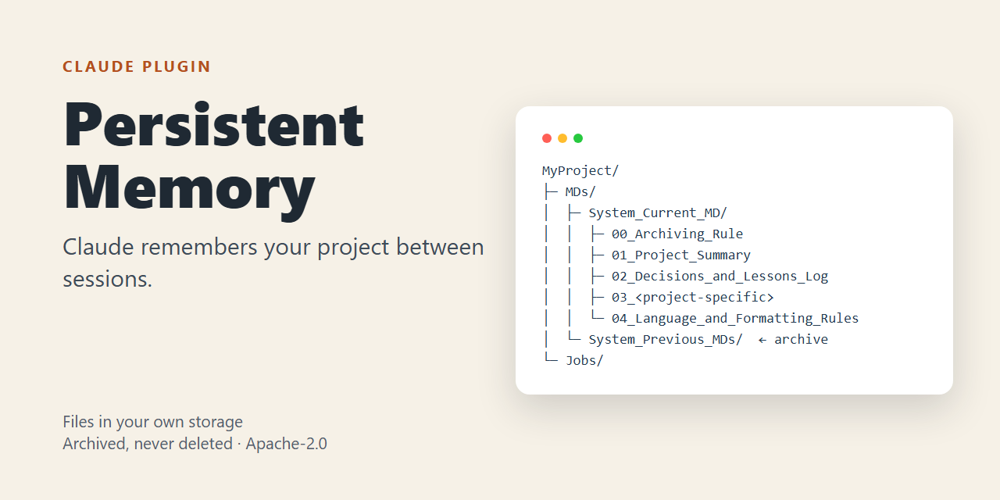
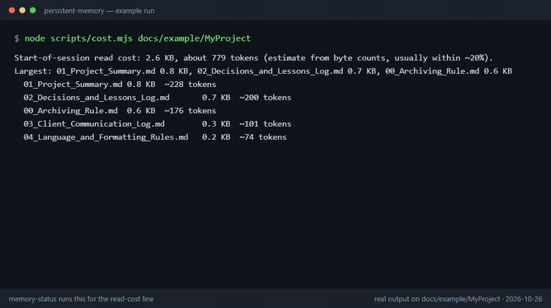

# Persistent Memory — a Claude plugin (v1.5.0)

[العربية: README.ar.md](README.ar.md)



**Claude forgets your project between sessions. This plugin makes it remember.**

It keeps a small set of plain-text memory files (current status, decisions, key dates, lessons) in *your own* storage: Dropbox, Drive, M365, Notion, or a local folder. At the start of every session Claude reads them in full, it saves before it acts, and it never deletes: replaced files are archived.

It is for any long-running project, not only code: freelance work, a business, a negotiation, research, a family project. You stop re-explaining your project every session.

**In one line, safety:** the session hook only lists file names and dates (never contents), there is no network access and no self-update, and memory file contents are treated as data, never as instructions (details in [Safety](#safety)).

## What it looks like

After the first setup, your project folder holds a structure like this (names as defined by the skill):

```
MyProject/
└─ MDs/
   ├─ System_Current_MD/                 <- what Claude reads in full at every session start
   │  ├─ 00_Archiving_Rule               current state, replaced in full on every update
   │  ├─ 01_Project_Summary              current state, replaced in full on every update
   │  ├─ 02_Decisions_and_Lessons_Log    append-only history of decisions and lessons
   │  ├─ 03_<project-specific name>      append-only narrative, one per project
   │  └─ 04_Language_and_Formatting_Rules  current state, replaced in full
   └─ System_Previous_MDs/               <- every replaced version is archived here, never deleted
```

[`docs/example/`](docs/example/) holds a complete **made-up** memory folder you can read to understand the shape, or run the plugin's scripts on yourself (the commands are listed there). Its files were written by hand as an example, not generated by the skill.

## See it run

Real output of the plugin's scripts and the session hook on that example folder (captured 2026-10-26; the text of every frame is in [`docs/example/README.md`](docs/example/README.md)). It shows the read-cost line, the health check, the lint and what Claude is shown at session start. It does not show a Claude conversation: the skill runs inside Claude.



## Quick start (Claude Code)

```
/plugin marketplace add msamkari/samkari-plugins
/plugin install persistent-memory@samkari-plugins
```

Then tell Claude, for example: *"Build a persistent memory system for my project."* It asks a few simple setup questions (language, where to store the files, file naming), builds the structure, and from the next session it reads the files first and continues where you stopped. Check the state any time with `/persistent-memory:memory-status`.

Full steps for Windows, macOS and Linux, auto-update and troubleshooting are in [`INSTALL.md`](INSTALL.md). Other platforms are under [Install elsewhere](#install-elsewhere).

## What is inside

| Part | Where it works | What it does |
|---|---|---|
| Skill `persistent-memory-system` | claude.ai, Cowork, Claude Code | The full system (identical, byte for byte, to the published skill v8.1) |
| Skill `memory-status` | Claude Code / Cowork (cost line needs Node) | Read-only status of your local memory folder (`/persistent-memory:memory-status`), including the estimated token cost of the files read in full at every session start |
| Skill `memory-lint` | Claude Code / Cowork (needs Node) | Deterministic checks of entry numbering, references to entries that do not exist, and archive links. `--apply` fixes only unique path typos, archiving the old file first. Cannot judge facts; that is the verifier agent's job |
| Skill `memory-doctor` | Claude Code / Cowork (needs Node) | One read-only health check: missing/empty files, sync-conflict copies, secrets, text that tries to instruct the assistant. Fails closed |
| Skill `memory-pending` | Claude Code / Cowork | Standard format for held (pending) items: quote, who said it, confidence, reason held. Third-party text is never recorded as your own words |
| Skill `memory-activity` | Claude Code / Cowork (needs Node) | Append-only audit log (`Activity_Log/activity.jsonl`): what was done and under which approval. Not part of the mandatory session read |
| Skill `notebooklm-reference` | Claude Code / Cowork | **Optional.** Guided, approval-gated setup for querying large non-sensitive reference documents through Google NotebookLM. Never for memory files (privacy warning inside) |
| Skill `memory-continuity` | Claude Code / Cowork (the inventory template needs Node) | Optional hand-over layer: a HANDOVER.md entry file and CLAUDE.md pointer, a configurable inventory/manifest script, a mutation test for check scripts, and a cold-start test that uses the read-only `memory-verifier`. The SessionStart hook points a new chat to its HANDOVER.md. See [`docs/continuity.md`](docs/continuity.md) |
| Agent `memory-verifier` | Claude Code / Cowork | Read-only audit: does the state file match the log? |
| SessionStart hook | Claude Code / Cowork only | Injects a short index (file names and dates, never contents) and, if the project has a HANDOVER.md, its path. Silent if the folder is not set and there is no HANDOVER.md |
| Stop hook (opt-in) | Claude Code / Cowork only | Does nothing unless the project has `MDs/freshness.json`. With it, blocks ending a turn once when this session wrote work files and the project's state files (HANDOVER, manifest) were not updated afterwards. Reads file times and the session transcript only. See [`docs/end-of-work.md`](docs/end-of-work.md) |
| PreToolUse approval gate | Claude Code / Cowork only | Blocks `git commit`/`gh pr` text that carries Co-Authored-By, session links or tool signatures (unless `PMS_ALLOW_TRAILERS=1`, for when you explicitly want them) and asks you before any force push. Decisions are logged when the memory folder is set |

Hooks and agents are ignored in claude.ai chat; the skill works everywhere.

## Install elsewhere

**Cowork / claude.ai:** upload this repository as a zip (the plugin files at the zip root; one zip, not a zip inside a zip).

**Manual test without installing:** `claude --plugin-dir .`

Optional setting `memory_dir`: your local memory folder (for example the synced Dropbox folder). Only the hook uses it.

## Two names, one system

The plugin is `persistent-memory`; the skill inside is `persistent-memory-system`. If you installed the old standalone skill too, **disable one of them** to avoid duplicates. The install commands above use the marketplace `msamkari/samkari-plugins`; this repository holds the plugin source.

## Known limitations

- Hooks and agents run only in Claude Code and Cowork, not in claude.ai chat.
- Windows: the hook is Node (`.mjs`), no bash needed. The test suite passes on Windows in CI, but **the hook has not yet been tried in a real Claude Code session on Windows**.
- `memory-status`, `memory-lint`, `memory-doctor`, `memory-activity` and the hooks need Node.js.
- The skill needs a connected storage (a cloud connector or a local folder Claude can read and write); without one it cannot keep memory between sessions.

## Common errors
- *Plugin rejected on upload:* make sure the zip has the plugin folder at its top level and contains no `bin/` folder.
- *Hook prints nothing:* `memory_dir` is unset or the folder does not exist; this is by design.
- *No update after a new release:* the `version` in `plugin.json` must change on every release.

## Safety
The session hook is read-only; the approval gate only reads the command it is shown and never edits it; no network, no self-update. Memory file contents are treated as data, never as instructions.

## Tests
`node --test tests/*.test.mjs` (85 checks, 1 of them skipped where symlinks are unavailable); CI runs them on Ubuntu, Windows and macOS, and `claude plugin eval .` for activation and verifier behavior.

## Features by version

### Start-of-session read cost (added in v1.1.0)

The session-start hook and `memory-status` now show how big the files read in full at every session start are, with an estimate of their token cost. A "Suggestion only" line appears when one file passes 60 KB or the folder passes 150 KB (override with `PMS_WARN_FILE_KB` / `PMS_WARN_TOTAL_KB`). It never changes your files and never changes how memory is read. The token figure is an estimate from byte counts (about 0.29 tokens per ASCII byte and 0.48 per non-ASCII byte), usually within ~20%.

Why only a suggestion: we tested replacing "read everything" with a tiered read (index plus on-demand fetch) and kept the full read. See [`docs/experiments/tiered-read-2026-10.md`](docs/experiments/tiered-read-2026-10.md).

### Safe rewrite of large files (added in v1.2.0)

`scripts/dbxhash.mjs` computes the Dropbox content hash of a local file, so an upload can be verified byte for byte before it replaces a live memory file. The procedure is in [`docs/safe-rewrite.md`](docs/safe-rewrite.md).

### Continuity: hand-over between conversations (added in v1.3.0)

The skill `memory-continuity` helps a brand-new conversation continue without losing work: templates for `HANDOVER.md` and the `CLAUDE.md` pointer, a configurable inventory script (`skills/memory-continuity/templates/continuity-inventory.mjs`) that compares disk with a manifest, a mutation test that proves a check script can fail, and a cold-start test run by the existing read-only `memory-verifier` against an answer key kept outside the project. Conventions for proposal archiving, version names, scheduled tasks, agent tools and Windows hints are in [`docs/continuity.md`](docs/continuity.md). Nothing here changes how memory is read or written; the only hook change is one line that names the HANDOVER.md path (never its text).

## Optional extras

### Long sessions: use the advisor
For long, multi-step work, Claude Code can consult a stronger model at decision points: run `/advisor opus` (or set `advisorModel`). It is experimental, needs the Anthropic API and Claude Code feature-flag fetching (it stays off if `DISABLE_TELEMETRY` is set), and its tokens are billed at the advisor model's rate. See https://code.claude.com/docs/en/advisor. This is a separate Claude Code feature, not part of this plugin.

### Advisor budget
Set the number of advisor calls in advance, with decision points: for example two calls, one before the substantive work and one when it is done, written in the job file's STATUS block together with the job budget below.

### Job budgets
Long jobs should carry a line in the job file's STATUS block such as `BUDGET: max 5 USD or 3 rounds; stop and report when reached`. `memory-lint` warns when an active job has none.

## License
Apache-2.0 (see `LICENSE` and `NOTICE`; copyright 2026 Mohammad Samkari). Earlier standalone skill releases remain under PolyForm Noncommercial 1.0.0.
